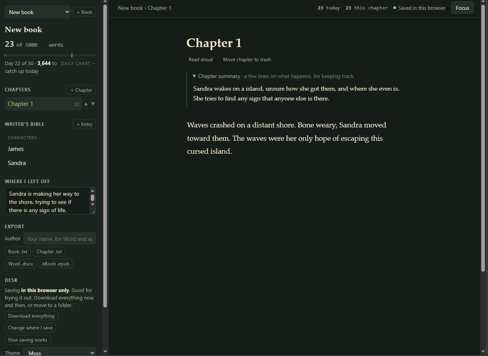

# Moss Writing Desk

A quiet place to write a novel, built to work with your AI.

Chapters down the left, one page in the middle, a short summary on every chapter, and a writer's bible for the names and details that must stay consistent. It is one single web page. Nothing to install.

## How saving works

Read this first, because it decides how you'll use the desk.

- **Built for Claude.** Open the desk as a Claude artifact and your writing saves to your Claude account. It follows you to any device, phone included, and the **Claude** button helps with chapter summaries, name checks, bible entries and "I'm stuck" ideas.
- **Works with other AI agents too.** Open `index.html` in Chrome or Edge on a computer and choose **A folder on this computer**. Every chapter becomes a plain text file in that folder, which any agent (Claude, Gemini, ChatGPT and others) can read and write. Put the folder inside Google Drive, Dropbox or OneDrive and it follows you to your other computers. Give your agent [AGENTS.md](AGENTS.md) so it knows the layout.
- **Just trying it out?** Choose **Just this browser**. Your writing stays in that one browser on that one device. AI agents can't reach it, and clearing your browser data clears it too. When you move to a folder later, the desk copies your books across for you.

**Privacy:** this page is just the tool. Your writing stays with you. The page sends nothing anywhere: no accounts, no trackers, no web fonts. The only AI that sees your book is the one you choose to show it to, under that company's rules.

## Getting started

1. Download `index.html` (and `AGENTS.md` if you'll use an agent).
2. Open `index.html` in your browser. Chrome or Edge on a computer if you want folder saving (see Which browser? below).
3. Pick where your writing should live.
4. Start Chapter 1.

To use it inside Claude instead, ask Claude to publish `index.html` as an artifact for you.

## Which browser?

The desk itself (writing, browser saving, export, Download everything) works in any modern browser.

**Folder auto-save** (the desk saving into a folder on its own as you type, which is what lets your AI agent work on the same files) needs a browser that lets web pages open a folder:

- **Chrome** on a computer: tested, works.
- **Edge** and **Opera** on a computer: use the same engine as Chrome and should work, but haven't been tested yet.
- **Brave:** switched off by default for privacy. Use browser saving and Download everything, or open the desk in Chrome or Edge for folder saving. Brave also hides its list of voices, so Read aloud uses its default voice.
- **Firefox and Safari:** no folder saving. Browser saving and Download everything work.
- **Phones and tablets:** no folder saving. Use the desk inside Claude, or browser saving.

## Working with your AI agent

Point your agent at your desk folder and give it `AGENTS.md`. It explains:

- where chapters, summaries, the bible and the "where I left off" note live, and their format
- to ask you at the start whether to **save as you go** or **only at the end of a section** (or when you say "save")
- to read the bible, the summaries and your "where I left off" note first, **not the whole manuscript**, and to open a full chapter only when it is working in it. Summaries are what keep a long book from overloading your AI
- to keep the bible up to date by suggesting changes you approve, and to flag contradictions
- how to start a new book
- to suggest a better way to connect, if your AI platform has one

When your agent changes files while the desk is open, the desk picks the changes up when you click back into it, or press **Reload from folder**.

## Ways to use it

- **Dictating.** Talk it out loosely; your agent cleans up the grammar, fills in the small pieces, and puts anything it invented in [brackets] so you can decide.
- **Typing.** Write straight into the page. It saves as you go.
- **Editing and revision passes,** one chapter at a time.
- **Brainstorming and outlining** into chapters with a title, a few notes and a summary each.
- **Continuity checking** against the bible and the summaries: misspelled names, eyes that changed colour.
- **Bringing in a book you already wrote.** Your agent imports it one chapter at a time, writing each summary and bible note as it goes. It takes more tokens than pasting the whole thing, but it won't choke.
- **Listening back.** Press **Read aloud** on a chapter and your browser reads it to you in its own free voice, starting from your cursor. Great for catching clunky sentences. Pick a voice under Desk. Voices listed under "On this computer" stay on your machine; voices marked online (such as Edge's Natural voices) send the words being read to that company to be spoken, and the desk tells you so.
- **Sprints and word goals,** NaNoWriMo style. Set a goal, watch the daily chart, see how far ahead (or behind) of pace you are.

## What's in it

- Several books side by side, with a book switcher
- Chapters you can reorder, rename and trash (and restore)
- A summary on every chapter
- A writer's bible: characters, places, things, groups
- A "where I left off" note for future you
- A word goal with a daily chart, today's words and words per chapter
- Focus mode (everything but the page fades away; Esc to leave)
- Read aloud, using your browser's built-in voice
- Four themes: Dark, Light, Sepia and Moss
- Works on phones (in Claude or in browser mode)

## Export and backups

- **Export:** the whole book or one chapter as plain text, the whole book as Word (`.docx`) or as an eBook (`.epub`). Fill in the Author box first if you want your name on the title page.
- **Download everything:** every book as a zip of plain files, in the same layout as a desk folder. Unzip it into a folder and open that folder in the desk, and you're back.
- **Automatic backups** (folder mode): once a day, the first time you write, the desk saves a zip of that book into `_backups/` in your desk folder and keeps the last 14.

Your book is never trapped in here.

## Shared as-is

This is a tool I made for my own writing and decided to share. It is free and shared as-is. If it breaks, have your AI fix it. It is one HTML file, and AI is good at that.

Made by [LelulaGames](https://lelula.itch.io). If it helps you, a [tip on Ko-fi](https://ko-fi.com/lelulagames) is always appreciated. ♥

## License

MIT. Use it, change it, share it; keep the license and credit with it. See [LICENSE](LICENSE).
